# The Session: flow, motion and layout review (10 Nov 2026)

Played on a review server (port 8093, demo data) with Playwright, headless Chromium, on the commit `78dc7f7` (D-104):

- Quick, 1366×657, guide on, delegates on, motion on (Comet Halcyon-7 as New Zealand);
- Standard, 1536×753, guide off, delegates on, motion on;
- Quick, 1920×969, guide off, delegates off, motion off.

No page errors and no console warnings in any run. The grand look holds up at all three sizes: nothing in the frame, the
banner, the command bar or the bottom bar overflowed the window, and the panels stayed inside the stage. The problems
are in what happens between a player's moves, in a few effects that are hidden or that break with motion off, and in
copy that describes an older version of the game.

Items are ranked by value to the player. Effort: S under an hour, M a few hours, L a day or more. "Done" marks items
fixed in this branch; the rest are proposals.

## 1. The vote sweep plays behind the Summit panel (M) — done

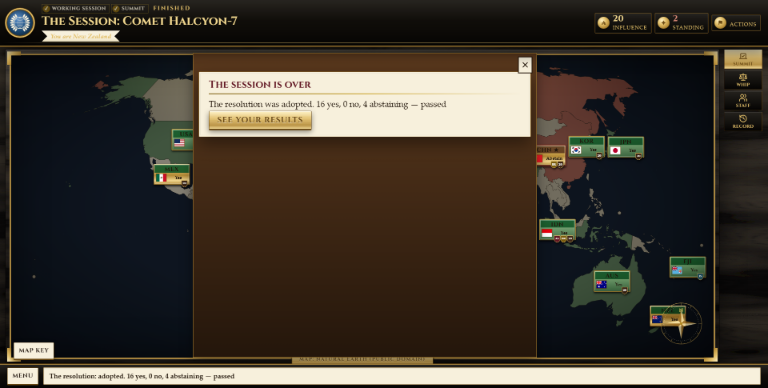

**Seen.** At the Summit every panel floats centre stage (phase 13). The vote sweep (tokens turning west to east, then
the Adopted / Rejected stamp) plays on the map behind the panel, dimmed, for every amendment and for the final vote. A
player sees the result as one line in the ticker. The stamp was also positioned for the old right-hand rail
(`.s-verdict { right: 546px }`), so it sat off-centre on the map.

**Why it matters.** The votes are the climax of the session and the one moment the room should be watched, not read.

**Fix.** When a move comes back with votes, close the panel, play the sweep over the undimmed map, then bring the panel
back (an amendment, after about 3.5 s) or let the result card take over (the final vote). Centre the stamp for the
command-bar layout. Files: `app/static/js/session.js` (`move`, `sweep`), `app/static/css/session.css`
(`.s-stage .s-verdict`). `tests/ui/test_session_ui.py::_through_the_summit` now allows more loop iterations, because
each vote's step takes longer; it checks the same things.

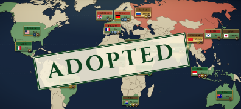

## 2. The President asks each procedure question twice (S) — done

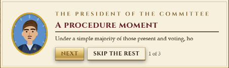
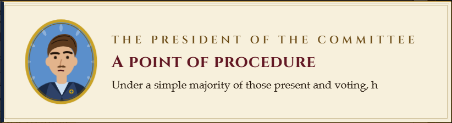

**Seen.** Every other turn the reel opens with a President card, "A procedure moment", that types out the question in
full, then adds "A procedure question is waiting on your Brief." The reel ends, and the President's procedure window
opens and types the same question again before showing the answers. The Brief line is stale: the question has had its
own window since 8 Nov.

**Why it matters.** It doubles the reading at the start of a turn, and the stale line sends a player to the Brief for
nothing.

**Fix.** Leave the procedure card out of the reel when a question is waiting (the window follows at once), and drop the
Brief line. File: `app/static/js/session-reel.js`.

## 3. A talk's result lingers on every later conversation (S) — done

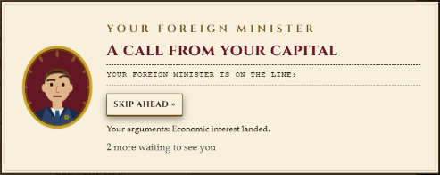

**Seen.** After a talk, "Your arguments: … landed" is inserted above the answer buttons. It is never removed, so it
shows under the Foreign Minister's call, the caucus address, the caucus reactions and a rival's ultimatum for the rest
of the turn, and it only goes when the next talk replaces it.

**Why it matters.** Wrong information on the wrong card; a player wonders what the Minister's call has to do with India.

**Fix.** Clear the intel box whenever a conversation card is drawn. File: `app/static/js/session-dialogue.js`.

## 4. With motion off, the ticker is empty and the debrief chart has no lines (S) — done

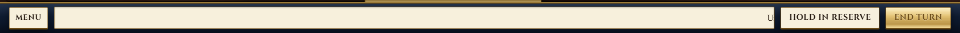
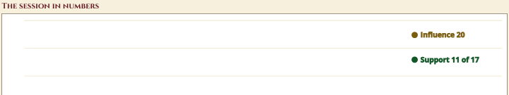

**Seen.** `.s-nomotion *` sets `animation: none`. The ticker's text is pushed off by `padding-left: 100%` and never
scrolls in, so the bar is blank. The debrief chart's lines are drawn by a dash animation, so they stay invisible.
`prefers-reduced-motion` has the same two problems.

**Why it matters.** Motion off is a setting the game offers, and a system setting some students have. It must lose the
movement, not the information.

**Fix.** With motion off, the ticker shows the latest line, static; the chart lines are drawn at full length. Files:
`app/static/js/session.js` (`ticker`), `app/static/css/session.css`.

## 5. The Summit panel keeps its scroll position across steps (S) — done

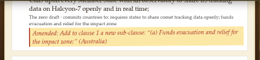

**Seen.** At the Summit a player scrolls down to the vote buttons. The next step (the next amendment, the final text)
renders into the same panel at the same scroll offset, so its heading and the first clause are above the fold.

**Fix.** Scroll the panel to the top whenever the Summit's step changes. File: `app/static/js/session-summit.js`.

## 6. Copy still describes clause-by-clause votes and a chosen path (S) — done

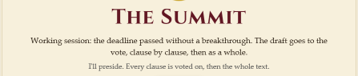
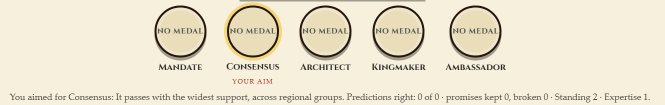

**Seen.** The Summit's stage card says "The draft goes to the vote, clause by clause, then as a whole" and "Every clause
is voted on"; the Brief's goal line and the walkthrough's Summit step say the same. The Summit has run as statements,
reading, caucus, amendments and one final vote since D-102. The result card says "your aim" and "You aimed for
Mandate" although no path is chosen since 9 Nov, and ends with "Expertise 1", a meter that was removed in phase 12.

**Fix.** Describe the real order of business; call the medal "your best path"; drop Expertise. Files:
`app/static/js/session.js`, `app/static/js/session-walk.js`.

## 7. The walkthrough has two consecutive "ways to win" steps, one of them wrong (S) — done

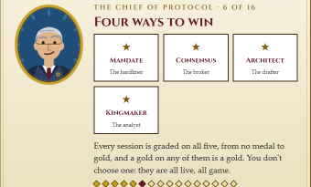

**Seen.** Step 6 is "Four ways to win" (four cards, text about "all five"); step 7 is "Five ways to win" (the list of
five). A Quick session's walkthrough runs to 16 steps because the stage 2 and 3 steps are added on.

**Fix.** One step, "Five ways to win", with five cards and the list. File: `app/static/js/session-walk.js`.
The length of the Quick walkthrough (16 steps before the first turn) is a design call for Ben: the stage 2 and 3
tools could instead be introduced when a Quick player first opens Coalition or Staff.

## 8. Scenario titles break one word to a line on a 1366 laptop (S) — done

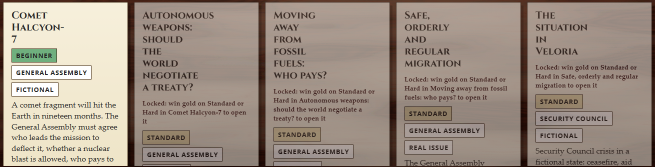

**Seen.** `.s-pick h3` keeps `padding-right: 104px` for the "Chosen" badge on every card, chosen or not. With five
250px cards across, the title has about 110px and breaks one word to a line ("Autonomous / weapons: / should / the /
world …").

**Fix.** Reserve the badge's space only on the chosen card, and let the grid use four wider columns at this width.
File: `app/static/css/session.css`.

## 9. The start of a turn is long: reel, question, then two to four visitors (M, proposal)

**Seen.** Turn 2 of the Quick session, answered by a bot as fast as the cards allowed, took 15 s and 13 clicks before
the first free move: a three-card reel, the procedure question (two cards), the Minister's call (two exchanges), the
caucus (two), an ultimatum (two). A player reading each line takes two or three minutes. The reel's "Next" and the
visits' answers are the same gesture over and over, and a bloc caucus runs with the same "Demand their support / …"
choices every turn.

**Why it matters.** Pacing. The design's own target was "fewer pop-ups" (phase 12), and the visitor count has since
risen to four. Ben's playtest will show whether this is too much; the numbers above say it probably is on turns with a
question and a caucus.

**Proposals, for Ben.** (a) Fold the "The X Group meets" reel card into the caucus visit that follows it (it says the
same thing). (b) Let the capital's call arrive as a telegram on the Brief unless it needs an answer. (c) Cap visitors at
two on turns with a procedure question. All three touch `visits.py` or the reel's build; (a) is front end only.

## 10. The reel's cards spring in with a wobble (S) — done

**Seen.** Every reel card, visit and breakthrough card animates in with `s-card`: a rise with a 2° rotation and an
overshoot (`cubic-bezier(.2, 1.2, .35, 1)`). Ten or more cards a turn each wobble into place.

**Why it matters.** Against the mahogany-and-brass look a repeated bounce reads as a toy. A card set down on a desk
settles; it doesn't spring.

**Fix.** A quieter entrance for the conversation and reel cards: a short rise and fade with a gentle ease, no rotation.
The stage card and the breakthrough card keep the fuller entrance, since each appears once. File:
`app/static/css/session.css` (`.s-reel-in`).

## 11. Motion off still waits 2.9 s after the final vote (S) — done

**Seen.** `sweep()` returns a fixed 2900 ms for the stamp even when nothing animates, so with motion off the result
card arrives after a blank wait.

**Fix.** Shorten the wait to the stamp's reading time when motion is off. File: `app/static/js/session.js`.

## 12. After the stage card, the Draft panel opens before the player has seen the table (S, proposal)

**Seen.** In the Working group and in a Quick session the Draft panel opens centre stage straight after the stage card
(and, with the guide on, after a 16-step walkthrough, the stage card and the reel). The first sight of the map is
through a dimmed panel background.

**Proposal.** Open the stage's panel only on the first turn of a Standard session's stage 2 and 3 (where it introduces
a new tool), and let the Working group start on the open map with the Draft badge showing the clause count. One line
in `afterStageCard` (`app/static/js/session.js`); Ben's call, because the panel was added to point new players at
the draft.

## 13. The title screen's four paths are cut off at 1366×657 (S, proposal)

**Seen.** The hero column is 687px tall in a 633px space; the bottom row of the paths grid is clipped unless the
player notices the column scrolls. On 1920×969 it fits.

**Proposal.** Hide the paths grid below 700px of height, or tighten the hero's gaps; the title page is read once.
File: `app/static/css/session.css`.

## 14. The turn reel could open on top of a visit (S) — done

**Seen.** Once in four runs, at the start of turn 3, a delegate's visit opened in the half-second before the reel, and
the reel then opened over it; neither card could be answered until the reel was dismissed. The visits wait for an open
card before showing (`next()`), but the reel didn't.

**Fix.** The reel waits like the visits do. File: `app/static/js/session-reel.js` (`play`).

## Checked and fine

- No console errors or page errors in three full sessions.
- Layout at 1366×657, 1536×753 and 1920×969: the banner, command bar, panels, cards, the deal table, the whip sheet
  and the result dossier all stayed inside the window; panel text is 16px or larger.
- Motion on: the meters roll, tokens flip, the ink effect on the reading, faces react, medals drop gold last, the
  telegram and news paper arrive; none of these fired more than once for the same change.
- Motion off: nothing animated except the two items in 4.
- Keyboard: Escape, number keys in conversations, E to end the turn, Y/A/N at the Summit all worked.
